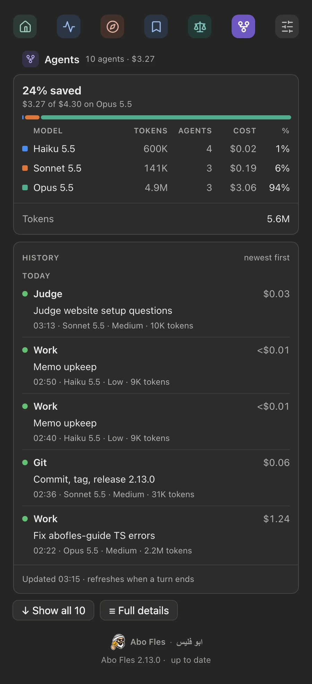

# Abo Fles — ابو فليس

**Your Claude Code agents spend like it's a wedding. Abo Fles holds the wallet.**

A free plugin for Claude Code that picks the model and effort for every subagent: Haiku reads, Sonnet checks, Opus builds. Every task ends with a receipt in real tokens and dollars. Before a question reaches you, a Judge agent tries to answer it from the repo. After Verify passes, 13 specialist reviewers check the work. It covers 1,317 topics in 31 domains, for developers, designers and marketers.

**Website: [abofles.com](https://abofles.com)** · [Install](https://abofles.com/install/) · [The pane](https://abofles.com/pane/) · [Changelog](https://abofles.com/changelog/) · Instagram [@abofles](https://www.instagram.com/abofles/)

```
/plugin marketplace add Sajadh92/abofles
/plugin install abofles@sajadh92
```

<p align="center"></p>

The screenshot is the real pane from one real session: 10 agents cost **$3.27 instead of $4.30** on Opus 5.5 (24% saved). Opus did the writing; the reading cost two cents.

| Plugin | What it does |
|---|---|
| [abofles](plugins/abofles) | Routes each subagent to the right model and effort, caps agents per task, judges questions before they reach you, runs specialist reviewers, prints receipts, keeps a work memo. |
| [abofles-guide](plugins/abofles-guide) | Companion mod: the **Abo Fles pane** on the right of the Claude desktop app (Home, Running, Guide, Resume, Decisions, Agents, and an Overrides editor that saves the `## abofles overrides` block), and the `🧭 next` guide band above the prompt box. `/abofles-pane` opens or closes the pane. |

## Install

```
/plugin marketplace add Sajadh92/abofles
/plugin install abofles@sajadh92
/plugin install abofles-guide@sajadh92   # optional: the Abo Fles pane and the guide band
```

Then add to `~/.claude/CLAUDE.md`: `- Use the abofles skill once per session, before the first coding, design or marketing task or subagent (never re-invoke it per task: it stays in context), and tier every task with it.`

## Updates

Auto-update is off by default for third-party marketplaces. Turn it on once: run `/plugin`, open **Marketplaces**, pick `sajadh92`, choose **Enable auto-update**. Claude Code then installs each new version at startup.

To update by hand instead:

```
/plugin marketplace update sajadh92
```

Then restart Claude Code.

See [plugins/abofles/README.md](plugins/abofles/README.md) for a quick start, the override block and the full matrix. Changes: [CHANGELOG.md](CHANGELOG.md). Website source: [site/](site) (`python3 site/build.py`). License: MIT.

Independent open-source project. Not made or endorsed by Anthropic.
